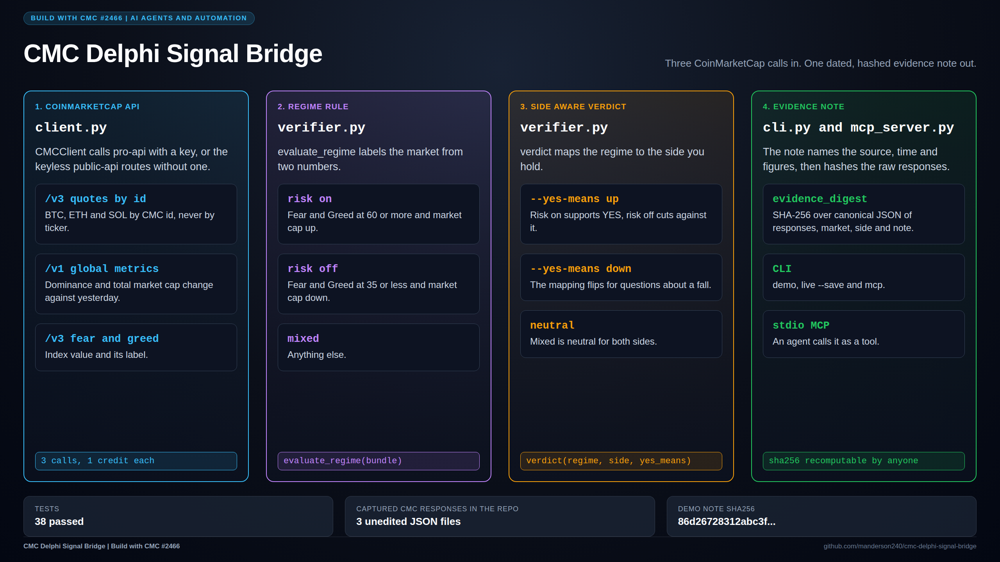

# CMC Delphi Signal Bridge

A small tool that turns live CoinMarketCap data into a dated evidence note for one side of a prediction market. It reads the asset the question is about (BTC, ETH or SOL), BTC, the total market cap and the Fear and Greed Index, labels the market risk on, risk off or mixed, and says whether that supports, cuts against or is neutral for the side you hold. Every note carries a SHA-256 over the raw CMC responses it was built from, so anyone with those responses can check it.

The name comes from the oracle at Delphi. The tool does not connect to or post on any particular market.

It runs as a CLI or as a stdio MCP server, so an agent can call it as a tool. It uses only the Python standard library.

I built it because forecasting agents tend to write notes like "the market looks bullish" with no date and no numbers. A note that names its source, its timestamp and the exact figures, and can be traced back to the bytes it came from, is much easier to trust or argue with.



Demo video (115 seconds, 2560x1440, narrated): [cmc_bridge_demo.mp4](https://raw.githubusercontent.com/manderson240/cmc-delphi-signal-bridge/main/docs/cmc_bridge_demo.mp4). Every code panel in it is cut from the current source and every terminal panel is real output from the captured responses.

## CoinMarketCap endpoints

Three calls per note, one credit each:

| Endpoint | What I use from it |
|---|---|
| `GET /v3/cryptocurrency/quotes/latest?id=1,1027,5426` | price, 24h change and market cap of the asset the note is about (BTC, ETH or SOL), plus BTC for context |
| `GET /v1/global-metrics/quotes/latest` | BTC dominance and `total_market_cap_yesterday_percentage_change` |
| `GET /v3/fear-and-greed/latest` | index value and its label |

With `CMC_API_KEY` set, the client calls `https://pro-api.coinmarketcap.com` with the `X-CMC_PRO_API_KEY` header. Without a key it calls the same routes under `/public-api`, which CMC serves anonymously with a low rate limit.

Coins are requested by CMC id, not by ticker. Asking for `symbol=BTC` returns 14 different coins that use that ticker.

## Real responses in the repo

`src/cmc_delphi_bridge/samples/` holds three unedited responses from the keyless API, captured on 2026-11-26 at 05:20 UTC. The offline demo and the tests run on them. `uv run cmc-bridge demo` prints JSON. Its `note` and `sha256` fields are:

```
As of 2026-11-26T05:20:17.241Z, CoinMarketCap shows BTC at $60,871.35 (+2.87% over 24h, market cap $1,224.58B),
BTC dominance at 58.72%, total market cap +2.56% against yesterday, and the Fear and Greed
Index at 10 (Extreme fear). I read that as a mixed market, which is neutral for YES on
"Will BTC close the week higher than it opened?".

86d26728312abc3f6bffb4dcca5960e31a703d891aca1ca9ed3b0ed58d7df93e
```

Fear at 10 points down and a market cap up 2.56% point up, so the rule calls it mixed.

## How it works

- Risk on: Fear and Greed at 60 or more and total market cap up on the day.
- Risk off: Fear and Greed at 35 or less and total market cap down on the day.
- Anything else is mixed.
- `--yes-means up` (the default) says a YES outcome needs prices to rise. Use `--yes-means down` for questions like "Will BTC fall below X?". Risk on supports the side that needs prices up, risk off supports the side that needs them down, and mixed is neutral for both.

The digest is `sha256` of the canonical JSON (sorted keys, no spaces) of `{"responses": {quotes, global_metrics, fear_and_greed}, "market_address", "side", "note"}`. `evidence_digest()` recomputes it.

## Quickstart

```bash
uv sync
uv run cmc-bridge demo                                  # offline, from the captured responses
uv run cmc-bridge demo --asset ETH --question "Will ETH close the week higher than it opened?"   # ETH or SOL: its own price, move and market cap
uv run cmc-bridge demo --question "Will BTC fall below $55,000 this week?" --side NO --yes-means down
uv run cmc-bridge live --save receipts/now.json         # three live calls, saves responses and note
uv run cmc-bridge mcp                                   # stdio MCP server
```

For `live`, put a free key in `.env` (`cp .env.example .env`, then set `CMC_API_KEY`). The keyless routes work for a few calls and then return HTTP 429 with error 1022.

The MCP server has two tools. `cmc_market_regime` returns the numbers and the label. `cmc_evidence_note` takes `market_address`, `question`, `side` and optional `yes_means` and `asset` (BTC, ETH or SOL, default BTC). Both take `offline: true` to use the captured responses.

```json
{"mcpServers": {"cmc-bridge": {"command": "uv", "args": ["run", "--directory", "/path/to/cmc-delphi-signal-bridge", "cmc-bridge", "mcp"]}}}
```

## Configuration

| Variable | Read by | Required |
|---|---|---|
| `CMC_API_KEY` | `load_api_key()` in `client.py`, from the environment or a local `.env` | No. Without it the client uses the keyless `/public-api` routes, which are rate limited. The offline `demo` and the tests never need it. |

## Tests

```bash
uv run pytest -q    # 38 tests, no network
```

They cover the regime thresholds on both sides of each boundary, every regime, side and direction combination (risk on and risk off with YES and NO, each for up and down questions, plus mixed), ETH and SOL notes that use their own captured quote, an unknown asset being rejected, picking BTC by id when another coin shares the ticker, a Fear and Greed value of 0, the digest changing when any one of the three responses changes, even in a field the note does not use, a missing Fear and Greed value raising an error instead of being guessed, keyless versus keyed URLs and headers, the CLI, and the MCP server over stdio. I also mutation-tested the verifier: each of eight deliberate bugs (threshold off by one, `and` swapped for `or`, a verdict that always says supports, the side flip removed, selecting by ticker, a digest without the responses, `or 50` or a `.get(..., 50)` default on the index read) makes at least one test fail.

## Hackathon deliverables

- Repository: this one, MIT licensed.
- Architecture diagram: `docs/architecture_diagram.png`.
- Demo video: `docs/cmc_bridge_demo.mp4`, 115 seconds, 2560x1440, narrated.
- BUIDL text: `BUIDL_SUBMISSION.md`.
- API notes: `docs/cmc_api_feedback.md`.

## Limits

- The regime rule is two thresholds, not a model. It is meant to be read and argued with, not trusted blindly.
- The note covers BTC, ETH and SOL, chosen with `--asset` or the `asset` argument. It does not read the asset from the question text.
- The tool builds the note. It does not post it to any market.

API notes, including what got in the way: [docs/cmc_api_feedback.md](docs/cmc_api_feedback.md).

## Future roadmap

Pick the asset from the question text instead of an argument, and add more coins by adding their CMC ids.

## License

MIT, see [LICENSE](LICENSE).
